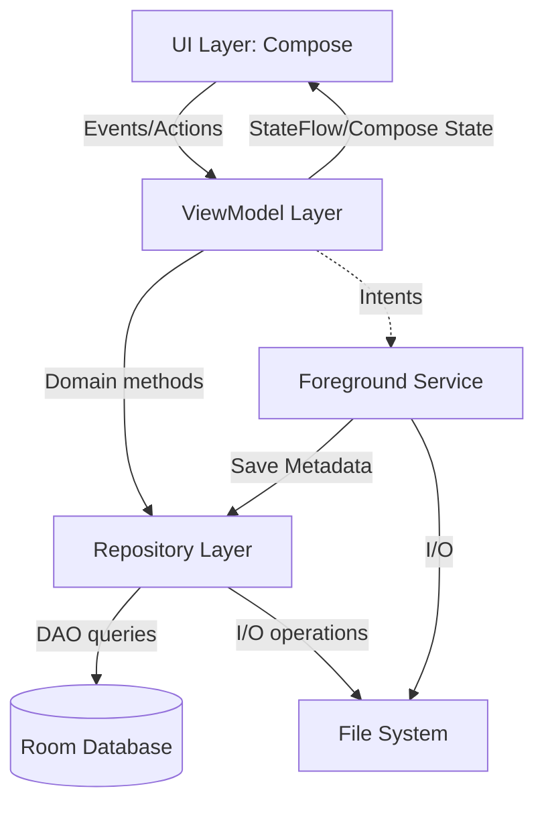

# A11 — Полный технический аудит Android-приложения 404BNF

## 1. Контекст аудита
- **Назначение:** Документирование текущего состояния Android-модуля (ветка `dev/android`) для подготовки к будущему редизайну пользовательского интерфейса и интеграции локального ML.
- **Git SHA:** `b451db9c6e2b6560941b1f262baac335366279b4`
- **Исследованная ветка:** `dev/android`
- **Границы аудита:** Аудит распространяется исключительно на исходный код и ресурсы внутри каталога `src/android/app/src/main/` и тесты в `src/android/app/src/test/`. Функциональность ML-интеграции (которая разрабатывалась в ветке `feat/android-ml-integrated`) в данной ветке отсутствует и не рассматривается как реализованная.
- **Состояние рабочего дерева:** Чистое (clean).
- **Ограничения сборки:** Команда `./gradlew :app:testDebugUnitTest :app:assembleDebug` не была запущена из-за отсутствия системной переменной среды `JAVA_HOME`. Выводы о тестировании сделаны на основе статического анализа наличия и содержимого файлов.

---

## 2. Обзор приложения
Приложение 404BNF — это инструмент для записи, импорта аудио, а также импорта, просмотра и редактирования расшифровок (транскрибации) с диаризацией (разделением по спикерам). 
Ветка `dev/android` представляет собой UI-модуль и бизнес-логику управления аудиозаписями и транскрипциями без встроенного ML-ядра распознавания речи. Транскрипции можно импортировать в виде JSON файлов (доступно только в Debug-сборке).

---

## 3. Полная карта архитектуры

Приложение реализует паттерн MVVM (Model-View-ViewModel) в связке с Unidirectional Data Flow (StateFlow), Jetpack Compose для UI, Room для хранения метаданных и файловой системой для бинарных данных.

### Диаграмма архитектурных слоев

### Структура директорий
- `com.team404bnf.app.ui.*` — слой представления (Compose-экраны, диалоги).
- `com.team404bnf.app.playback.*` — контроллер ExoPlayer и логика экспорта (WAV, MP3).
- `com.team404bnf.app.recording.*` — слой захвата аудио (`AudioCapture`, `RecordingService`).
- `com.team404bnf.app.data.repository.*` — логика работы с данными (`RecordingRepository`, `TranscriptRepository`, `AudioImportManager`).
- `com.team404bnf.app.data.db.*` — DAO, сущности и `AppDatabase` (миграции и инициализация).
- `com.team404bnf.app.transcription.*` — парсер JSON, структуры данных для расшифровок, логика редактирования.

### Описание основных классов
- **UI:** `MainActivity` (единая точка входа с Navigation Compose), `LibraryScreen`, `PlaybackScreen`, `RecorderScreen`.
- **ViewModels:** `LibraryViewModel` (импорт аудио, удаление, навигация), `PlaybackViewModel` (просмотр расшифровки, редактирование, экспорт), `RecorderViewModel` (управление фоновой записью).
- **Сервисы:** `RecordingService` (управление микрофоном в фоне через `AudioRecord`, показ нотификаций).
- **Репозитории:** `RecordingRepository` (аудиозаписи), `TranscriptRepository` (расшифровки и правки к ним), `AudioImportManager` (импорт SAF файлов).
- **Экспортеры:** `WavFileExporter` (чистое копирование), `Mp3FileExporter` (декодирование WAV через кастомный парсер или MediaCodec и конвертация в MP3 с использованием библиотеки Jump3r).

---

## 4. UI Redesign Handoff (Передача дизайна)

Этот раздел описывает устройство UI-слоя, чтобы позволить следующему разработчику провести масштабный редизайн, не сломав бизнес-логику. 
На данный момент **бизнес-логика строго отделена от UI** — она живет во ViewModels и Repositories. Состояния пробрасываются в Compose как `StateFlow`. UI можно полностью заменить.

### Карта экранов

1. **`LibraryScreen` (Экран библиотеки)**
   - *Путь:* [`LibraryScreen.kt`](/home/sar/Projects/404BNF/src/android/app/src/main/java/com/team404bnf/app/ui/library/LibraryScreen.kt)
   - *ViewModel:* `LibraryViewModel`
   - *Функции:* Отображает список записей, запускает запись (`onNewRecording`), переход к плееру (`onSavedRecordingOpen`), удаление (`onDeleteRecordings`), импорт аудио (`onImportAudio`).
   - *Состояния:* `savedRecordings` (список сущностей из БД), `deleting`, `importing`.
2. **`RecorderScreen` (Экран записи)**
   - *Путь:* [`RecorderScreen.kt`](/home/sar/Projects/404BNF/src/android/app/src/main/java/com/team404bnf/app/ui/recorder/RecorderScreen.kt)
   - *ViewModel:* `RecorderViewModel` (которая общается с синглтоном `RecordingSession.state`)
   - *Функции:* старт, пауза, возобновление и стоп записи через Intent-запросы к `RecordingService`.
   - *Состояния:* статус записи, длительность.
3. **`PlaybackScreen` (Экран плеера и транскрипции)**
   - *Путь:* [`PlaybackScreen.kt`](/home/sar/Projects/404BNF/src/android/app/src/main/java/com/team404bnf/app/ui/playback/PlaybackScreen.kt)
   - *ViewModel:* `PlaybackViewModel`
   - *Связанные компоненты:* `RecordingDetailHeader.kt`, `TranscriptMessages.kt`, диалоги редактирования.
   - *Функции:* Проигрывание аудио (`PlaybackController`), импорт JSON расшифровки (только в Debug), редактирование спикеров и текста, экспорт (TXT, JSON, WAV, MP3).
   - *Состояния:* `playbackState`, `transcriptDisplayState`, `screenState`, `recoveryState`.

### Схема навигации
Реализована через `NavHost` в `MainActivity.kt`:
- Начальный экран: `library`
- Переход к записи: `recorder`
- Переход к плееру: `player/{recordingId}`
Переходы выполняются с использованием `navController.navigate()`.

### Механизмы управления состоянием
- Во ViewModels используется `MutableStateFlow` (`.asStateFlow()`).
- В Compose используется `collectAsState()` или `collectAsStateWithLifecycle()`.
- Исключение: глобальное состояние микрофона хранится в `RecordingSession.state` (`StateFlow`), к которому обращается `RecorderViewModel` и `RecordingService`.

### Зависимости и риски при редизайне
- **Можно безопасно менять:** Весь визуальный слой Compose (`Theme.kt`, расположение элементов, анимации, карточки).
- **Сложности:** `TranscriptMessages.kt` использует кастомную логику группировки (`TranscriptGrouping.kt`), которая объединяет реплики одного спикера. При редизайне нужно учитывать логику вычисления того, какие фрагменты текста принадлежат одному визуальному "сообщению", а также как прикреплять меню редактирования к этим группам. Сохранение и редактирование спикеров меняет JSON в `TranscriptRepository` и перестраивает `TranscriptDisplayState`.

---

## 5. Полный аудит подсистем

### Архитектура импорта аудио
- **Код:** [`AudioImportManager.kt`](/home/sar/Projects/404BNF/src/android/app/src/main/java/com/team404bnf/app/data/repository/AudioImportManager.kt)
- **Процесс:** Пользователь выбирает файл через SAF (`Intent.ACTION_OPEN_DOCUMENT` -> `LibraryScreen.kt` -> `Activity Result API`).
- Файл копируется из `content://` во внутреннюю директорию: `context.filesDir/recordings/{uuid}/audio.{ext}`.
- Проверяется длительность аудио (`MediaExtractor` и `MediaMetadataRetriever`), наличие видеотреков запрещено.
- **Матрица входных форматов:**
  - Разрешены при импорте (по расширению или MIME-типу): `wav`, `mp3`, `m4a`, `aac`, `flac`, `ogg`, `opus`, `amr`, `3gp`.
  - Распознается Android: проверяется через `MediaExtractor`.
  - *Риск:* Реальная работоспособность форматов не покрыта unit-тестами. Достоверно воспроизведение зависит от кодеков конкретного устройства.

### Архитектура записи аудио
- **Код:** [`RecordingService.kt`](/home/sar/Projects/404BNF/src/android/app/src/main/java/com/team404bnf/app/recording/RecordingService.kt), [`AudioCapture.kt`](/home/sar/Projects/404BNF/src/android/app/src/main/java/com/team404bnf/app/recording/AudioCapture.kt)
- **Процесс:** Выполняется в `ForegroundService` типа `microphone`.
- Использует `AudioRecord` (16000 Hz, Mono, 16-bit PCM).
- Сырые PCM данные потоково сбрасываются на диск. После остановки к PCM-файлу программно приписывается 44-байтовый заголовок `WAV`.
- Запись устойчива к сворачиванию приложения (сервисForeground). Пауза реализована путем временной остановки `AudioRecord`.

### Архитектура воспроизведения
- **Код:** [`PlaybackController.kt`](/home/sar/Projects/404BNF/src/android/app/src/main/java/com/team404bnf/app/playback/PlaybackController.kt)
- **Процесс:** Использует `Jetpack Media3 ExoPlayer`.
- Обновление позиции проигрывания транслируется в Flow каждые 250 мс.
- Поддерживает ускорения: 1x, 1.25x, 1.5x, 1.75x, 2x.

### Архитектура расшифровок (Транскрибации)
- **Сущности:** В базе Room существуют классы `SpeakerEntity` и `UtteranceEntity` (см. [`Entities.kt`](/home/sar/Projects/404BNF/src/android/app/src/main/java/com/team404bnf/app/data/db/Entities.kt)), но **они полностью не используются** (`RecordingDao` и `TranscriptSnapshotDao` не содержат к ним обращений). 
- **Хранение данных:** Вся расшифровка хранится как сырой JSON в строковом поле `rawJson` таблицы `transcript_snapshots`. Пользовательские правки отдельно сохраняются в поле `userEditsJson`. Это означает, что оригинальная транскрипция иммутабельна, а все правки накатываются поверх через `TranscriptUserEdits.apply(...)`.
- **Редактирование:** Смена спикеров, редактирование текста, разбиение на группы и удаление реплик сохраняется как патч в `userEditsJson`.
- **Импорт JSON:** Только в Debug сборке, доступно для подгрузки внешней расшифровки.

### Логика экспорта
- **WAV:** Чистое побайтовое копирование файла через `InputStream` -> `OutputStream` с проверкой RIFF WAVE заголовков (см. `WavFileExporter.kt`).
- **MP3:** Настоящее перекодирование с использованием `Lame` кодека (библиотека `de.sciss:jump3r`). Реализован кастомный декодер WAV на случай, если аудио было записано самим приложением, а также fallback-декодер `MediaCodec` для импортированных аудио (см. `Mp3FileExporter.kt`).
  - *Ограничения:* Перекодирование выполняется только в 128 kbps CBR (захардкожено в `gfp.brate = 128`).
- **TXT/JSON:** Экспорт текста и JSON-транскрипций (`TranscriptTxtFormatter.kt`, `TranscriptJsonExporter.kt`). Наличие юнит-тестов (`TranscriptTxtFormatterTest.kt`, `TranscriptJsonExporterTest.kt`) подтверждает работу форматов экспорта.

---

## 6. Связи с ML-подсистемой
**Ветке `dev/android` отсутствует ML-интеграция.** Здесь находятся только UI и бизнес-слои, способные принимать готовые JSON (например, через debug-опцию импорта JSON-файла).
- **Что необходимо проверить после перехода на Android + ML:**
  1. Где и как запускается ML-движок. В текущем виде `RecordingService` просто завершает WAV файл и сохраняет его в БД. ML, вероятно, должен перехватывать этот WAV файл или стримить PCM из `AudioCapture`.
  2. Будет ли заблокирован UI поток при инициализации ML.
  3. Куда и как будут сохраняться результаты ML распознавания (они должны сохраняться в БД в `TranscriptSnapshotDao.insertIfAbsent(...)`).

---

## 7. Асинхронность, жизненный цикл и безопасность
- **Асинхронность:** Все I/O операции в `AudioImportManager`, Экспортерах, DAO вынесены на `Dispatchers.IO` с помощью `withContext`. Длинные вычисления (парсинг JSON) вынесены на `Dispatchers.Default`. Утечек не наблюдается, используется `viewModelScope`. Отмена операций при закрытии экрана происходит корректно (т.к. корутины автоматически отменяются). Однако `RecordingService` работает в своем `CoroutineScope`, не привязанном к ViewModel, что обеспечивает живучесть записи.
- **Безопасность:**
  - Ограничение на импорт файла: `1024L * 1024 * 1024` байт (1 ГБ).
  - Названия файлов строго захардкожены (типа `audio.wav`), используется UUID записи для папки. Отсутствует риск Path Traversal.
  - Утечки `MediaExtractor`, `MediaMetadataRetriever`, `AudioRecord` предотвращаются через блоки `use {}` или `finally { it.release() }`.

---

## 8. Тестирование
- Существующие unit-тесты (находятся в `src/android/app/src/test/`):
  - `Mp3FileExporterTest.kt`
  - `TranscriptGroupingTest.kt`
  - `TranscriptUserEditsTest.kt`
  - `TranscriptTxtFormatterTest.kt`
  - `TranscriptJsonExporterTest.kt`
  - `TranscriptJsonParserTest.kt`
- Покрывают преобразование, группировку реплик и парсинг.
- Инструментальных тестов (`androidTest/`) не обнаружено (хотя папка может существовать).
- Тесты не запускались в ходе данного аудита из-за отсутствия локального окружения Java (состояние JDK). Ограничение среды.

---

## 9. Известные риски и рекомендации

### Потенциальные технические риски
1. **Неработающие таблицы БД (Низкий приоритет):** `SpeakerEntity` и `UtteranceEntity` создаются, но в коде не используются. Расшифровки хранятся в JSON. Риск: засорение схемы базы данных.
2. **Экспорт MP3 (Средний приоритет):** Падение приложения при OOM (Out of Memory) или ANR, если файл будет слишком длинным. Экспорт идет через `MediaCodec`, который может зависать на некоторых устройствах.
   - *Рекомендованная проверка:* Тестирование на реальном слабом устройстве, экспорт 2-часового файла в MP3.
3. **Конвертация импортированных форматов в MP3 (Средний приоритет):** Файлы типа `aac`, `m4a`, импортированные пользователем, не всегда корректно могут быть распарсены `MediaCodecAudioDecoder`, если частоты дискретизации или количество каналов нестандартные (поддерживаются только 1-2 канала).

### Рекомендации перед редизайном UI
- Архитектура полностью позволяет переписать слой Compose. Не удаляйте `PlaybackViewModel` и `LibraryViewModel` — просто создавайте свои Composable-функции, подписываясь на их состояния через `viewModel.state.collectAsState()`.
- Изучите логику `TranscriptGrouping.kt`, так как она отвечает за сложную склейку реплик спикеров. При переписывании чата транскрипции нужно будет использовать эту функцию.

### Перечень сценариев для регрессионного тестирования
- Запись аудио в фоне -> сворачивание приложения -> пауза -> возобновление -> остановка. Убедиться, что WAV сформирован.
- Импорт аудио -> проверка успешности создания записи -> попытка включить воспроизведение.
- Внесение правок в транскрипцию (смена спикера, удаление) -> экспорт в TXT -> экспорт в MP3.
- Повторное открытие той же записи: убедиться, что правки сохранились (так как они сохраняются в `userEditsJson`).