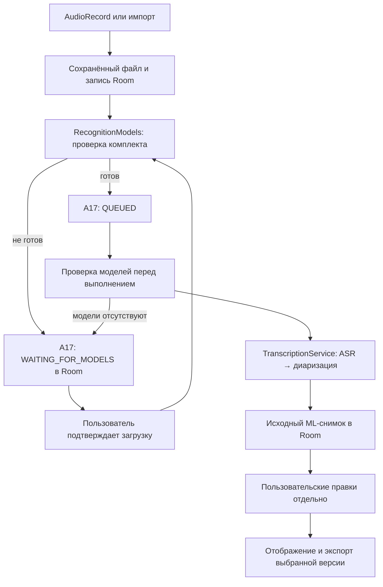

# Архитектура

## Компоненты

| Слой | Реализация |
| --- | --- |
| UI | Kotlin, Jetpack Compose / Material 3; Library, Recorder, Playback, Processing, Models |
| Состояние | ViewModel, StateFlow, Coroutines |
| Данные | Room: записи, исходные снимки расшифровок с отдельным JSON правок, задачи A17; DataStore для согласия и лимита импорта |
| Запись | AudioRecord, RecordingService, WAV-файл в приватном хранилище |
| Импорт | AudioImportManager → RecordingRepository; проверка дорожек и декодирования, затем файл и запись Room |
| Расшифровка | RecognitionModels, TranscriptionTaskManager, TranscriptionService, LocalTranscriptionPipeline |
| ML | Модуль `ml`, ONNX Runtime Android, GigaAM / Silero / WeSpeaker |
| Воспроизведение и экспорт | Media3 ExoPlayer, ограниченный предпросмотр; TXT/JSON, WAV, MP3 через системный диалог сохранения |

## Поток данных

A17 — существующая очередь: одна запись задачи на `recordingId`, идентификатор попытки, mutex переходов и блокировка ML. Ожидание моделей хранится в той же таблице, без отдельной ML-очереди. Готовые снимки проверяются перед запуском; отменённые попытки автоматически не возобновляются. Ошибки обработки не удаляют исходное аудио. Активная нативная обработка защищает модели от удаления; ожидающие в очереди задачи при удалении комплекта переводятся в ожидание установки.

После завершения процесса выполнявшиеся задачи становятся прерванными; состояние ожидания установки сохраняется. Ожидающие установки задачи возобновляются после успешной проверки моделей при загрузке/обновлении состояния приложения. Это не гарантия бессрочного выполнения FGS: действуют ограничения Android.

## Хранение и правки

Аудио находится в приватном `filesDir/recordings/<id>/`, модели — `filesDir/models/`. Промежуточный PCM создаётся в cacheDir и удаляется в `finally`. Обработка длинного аудио использует файл PCM и чанки вместо полного PCM-массива.

Группа сообщений — представление последовательных фрагментов одного говорящего, смежных в оригинале и с паузой до 1500 мс. Каждый фрагмент сохраняет свой ID и временные метки. Редактирование меняет overlay `userEditsJson`, а не исходный ML JSON. Скрытие обратимо; сброс очищает правки. TXT и JSON читают выбранную версию без изменения Room. Публичный JSON-экспорт содержит `transcript` с `speaker_id`, `start_ms`, `end_ms`, `text`; внутренний снимок богаче экспортной схемы.

`src/ml-core/` — отдельное Python-ядро для разработки и сверки, не runtime-компонент APK. [Ограничения](LIMITATIONS.md).
